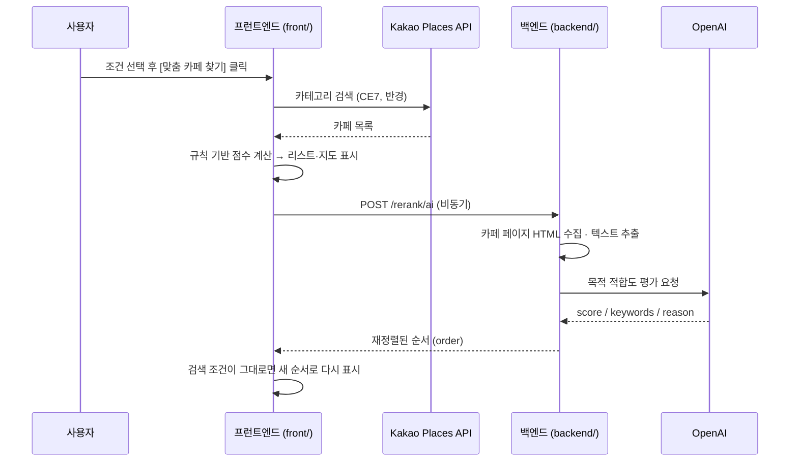

# ☕ Campus Café Finder

국민대학교 주변 카페를 **인원 · 목적 · 검색 반경**에 맞춰 추천하는 웹 애플리케이션입니다.

Kakao Places API로 실제 카페 목록을 가져와 프런트엔드에서 규칙 기반 점수로 먼저 정렬하고, 백엔드가 실행 중이면 카페 페이지 텍스트와 OpenAI 평가를 이용해 순서를 한 번 더 조정(재랭킹)합니다.

## 주요 기능

- **실제 카페 데이터 조회**: Kakao Places 카테고리 검색(`CE7` = 카페)으로 반경 내 카페를 가까운 순으로 수집
- **조건 선택**: 인원(1~10명), 목적(데이트 / 스터디 / 과제), 반경(500m / 1km / 3km / 5km)
- **규칙 기반 추천 점수**: 목적 키워드, 거리, 프랜차이즈 여부, 교내 여부, 인원을 반영한 0~100% 적합도
- **AI 재랭킹 (선택)**: 카페 페이지 스크래핑 + OpenAI 목적 적합도 평가 점수를 거리 점수와 합산해 순서 재정렬
- **지도 + 리스트 UI**: 결과 카페를 지도 마커로 표시, 리스트 항목을 클릭하면 해당 위치로 지도 이동, 카카오맵 / 네이버지도 바로가기
- **빈 결과 · 오류 안내**: 반경 내 결과가 없거나 카카오 검색에 실패하면 안내 문구 표시
- **반응형 레이아웃**: 태블릿·모바일 화면에서는 지도와 리스트를 세로로 배치

## 동작 흐름



백엔드가 꺼져 있거나 오류가 나도 1단계(규칙 기반) 결과는 그대로 표시됩니다.

## 프로젝트 구조

```
Campus_Cafe_Finder/
├── backend/
│   ├── server.js       # Express 서버: /health, /rerank, /rerank/ai
│   └── package.json
├── front/
│   ├── index.html      # 화면 구조, Kakao Maps SDK 로드
│   ├── script.js       # 카페 검색, 점수 계산, 지도·리스트 렌더링, AI 재랭킹 요청
│   └── style.css       # 스타일 및 반응형 레이아웃
└── README.md
```

## 기술 스택

| 구분 | 사용 기술 |
| --- | --- |
| Frontend | HTML, CSS, Vanilla JavaScript |
| 지도 · 장소 | Kakao Maps JavaScript SDK (`services` 라이브러리) |
| Backend | Node.js, Express 5, cors, dotenv |
| AI · 스크래핑 | OpenAI API (기본 모델 `gpt-4o-mini`), axios, cheerio, p-limit |
| Tools | Cursor, GitHub |

## 실행 방법

### 사전 준비

- Node.js 20 이상 권장
- [Kakao Developers](https://developers.kakao.com) 앱의 **JavaScript 키**
  - 앱 설정 > 플랫폼 > Web 에 `http://localhost:8000` 을 등록해야 지도·장소 검색이 동작합니다.
- OpenAI API 키 (백엔드를 실행할 경우)

### 1) 백엔드 실행

```bash
cd backend
npm install
```

`backend/.env` 파일을 만듭니다.

```env
OPENAI_API_KEY=sk-...
# 아래는 선택 항목
OPENAI_MODEL=gpt-4o-mini
PORT=5050
FRONT_ORIGIN=http://localhost:8000
```

```bash
npm run dev                          # http://localhost:5050
curl -s http://localhost:5050/health # {"ok":true}
```

> `OPENAI_API_KEY` 가 없으면 OpenAI 클라이언트 생성 단계에서 서버가 시작되지 않습니다.

### 2) 프런트엔드 실행

1. `front/index.html` 의 Kakao SDK 스크립트 `appkey=` 값을 본인 JavaScript 키로 바꿉니다.
2. `front` 폴더에서 정적 서버를 띄웁니다.

```bash
cd front
python3 -m http.server 8000
# 또는
npx http-server -p 8000
```

3. 브라우저에서 http://localhost:8000 에 접속합니다.

> 백엔드 주소가 `http://localhost:5050` 이 아니라면 `script.js` 를 불러오기 전에 `window.BACKEND_ORIGIN = 'http://...'` 를 지정하면 됩니다.

### 환경 변수 (`backend/.env`)

| 변수 | 필수 | 기본값 | 설명 |
| --- | :---: | --- | --- |
| `OPENAI_API_KEY` | ✅ | — | OpenAI API 키 |
| `OPENAI_MODEL` | | `gpt-4o-mini` | AI 재랭킹에 사용할 모델 |
| `PORT` | | `5050` | 백엔드 포트 |
| `FRONT_ORIGIN` | | (없음) | CORS 허용 Origin. 지정하지 않으면 `localhost` / `127.0.0.1` 의 모든 포트를 허용 |

## 추천 알고리즘

### 1단계 — 프런트엔드 규칙 기반 점수 (`front/script.js`)

카페의 **이름 · 카테고리 · 주소** 텍스트에서 키워드를 찾아 점수를 계산합니다.

```
기본점수 = W목적 × 목적점수 + W거리 × 거리점수 + 카테고리 보너스   (0~1로 제한)
적합도(%) = 기본점수 × 인원 보정 × 목적별 보정 × 100                 (최대 100)
```

| 요소 | 내용 |
| --- | --- |
| 목적 점수 (0~1) | 목적별 가점 / 감점 키워드 개수를 `log1p(가점) − 0.7 × log1p(감점)` 으로 완만하게 반영 |
| 거리 점수 (0~1) | 국민대 기준 직선거리(하버사인) ÷ 검색 반경. 국민대 동쪽(길음 · 성신여대 방향) 카페는 거리를 20% 짧게 계산 |
| 가중치 | 데이트 · 스터디 = 목적 0.70 / 거리 0.30, 과제 = 목적 0.75 / 거리 0.25 |
| 카테고리 보너스 | 데이트 목적에서 디저트 · 베이커리 · 브런치 키워드가 있으면 소폭 가산 |
| 인원 보정 (0.6~1.35) | 5명 이상: 프랜차이즈 +0.25, 소형 암시 키워드 −0.20<br>3~4명: 프랜차이즈 +0.15<br>2명 이하: 데이트면 디저트·브런치·감성 +0.08, 프랜차이즈 −0.05 / 그 외 목적은 프랜차이즈 +0.05 |
| 목적별 보정 (0.3~2.0) | **스터디**: 교외 프랜차이즈 크게 가산(+0.80), 대형·넓은·단체석 키워드 가산, 소형 · 교내 카페 감산<br>**과제**: 교내 카페 크게 가산(+0.70), 조용·집중 키워드 가산, 교외 프랜차이즈 · 혼잡 키워드 감산<br>**데이트**: 보정 없음 |

그 밖의 규칙

- **프랜차이즈 판별**: 스타벅스, 투썸, 이디야, 메가커피, 빽다방, 할리스, 커피빈, 컴포즈, 더벤티, 드롭탑, 탐앤탐스 (단, "플레이스엔"은 개인 카페로 취급)
- **교내 카페 판별**: 이름 · 주소에 "국민대"가 있거나 주소가 "정릉로 77"인 곳, 또는 국민대 좌표 50m 이내 (프랜차이즈는 교내 카페로 보지 않음)
- **데이트 목적**에서는 교내 카페를 결과에서 제외
- **검색 중심**: 반경 1km 이하는 국민대, 3km 이상은 국민대와 길음역 사이 지점. 3km 이상일 때 동쪽 카페는 반경의 1.25배까지 포함
- **추천 이유 문구**: 기본점수 0.55 초과 시 "조건 적합", 반경 절반 이내면 "가까운 거리", 둘 다 아니면 "균형적 적합"
- **정렬**: 적합도 내림차순, 같으면 가까운 순
- **캐시**: 반경을 늘릴 때만 Kakao API를 다시 호출하고, 같거나 줄이면 이전 결과를 재사용

### 2단계 — 백엔드 AI 재랭킹 (`POST /rerank/ai`)

1. 프런트엔드가 1단계 결과(이름, 주소, 카카오 장소 URL, 거리)를 보냅니다.
2. 최대 4개씩 병렬로 장소 페이지 HTML을 받아 `script` / `style` 을 지우고 본문 텍스트를 추출합니다(최대 8,000자, 프롬프트에는 앞 3,000자).
3. OpenAI에 목적 · 인원 · 카페 정보를 주고 `{ score: 0~1, keywords, reason }` 형식의 JSON을 받습니다(temperature 0.2).
4. 거리 점수(결과 내 최소~최대 거리로 정규화)와 AI 점수를 목적별 가중치로 합산합니다.

| 목적 | 거리 가중치 | AI 가중치 |
| --- | :---: | :---: |
| 스터디 | 0.60 | 0.40 |
| 데이트 | 0.55 | 0.45 |
| 과제 | 0.50 | 0.50 |

- 스크래핑이나 AI 호출이 실패한 카페는 AI 점수 0으로 처리합니다.
- 응답이 오기 전에 검색 조건이 바뀌거나 새 검색이 시작되면(요청 ID 비교) 그 응답은 버립니다.

## API

### `GET /health`

```json
{ "ok": true }
```

### `POST /rerank/ai`

요청

```json
{
  "purpose": "study",
  "peopleCount": 4,
  "cafes": [
    {
      "name": "카페 이름",
      "addr": "서울 성북구 ...",
      "url": "https://place.map.kakao.com/...",
      "distance_m": 320
    }
  ]
}
```

- `purpose`: `date` | `study` | `assignment` (기본 `study`)
- `cafes` 가 비어 있으면 `400` 을 반환합니다.

응답

```json
{
  "order": [2, 0, 1],
  "details": [
    {
      "idx": 2,
      "score": 0.71,
      "distanceScore": 0.9,
      "aiScore": 0.42,
      "keywords": ["넓은 좌석", "단체석"],
      "reason": "..."
    }
  ],
  "reasoning": "purpose=study, people=4, weights(distance=0.60, ai=0.40)"
}
```

- `order`: 요청한 `cafes` 배열의 인덱스를 추천 순서대로 나열한 값
- `details`: 카페별 점수 상세(점수 높은 순)

### `POST /rerank` (현재 프런트엔드에서는 사용하지 않음)

AI 없이 거리(0.7)와 이름 · 주소 키워드 매칭(0.3)만으로 재정렬하는 간단한 버전입니다. 요청 형식은 `/rerank/ai` 와 같고(`peopleCount`, `url` 불필요), 응답은 `{ order, reasoning }` 입니다.

## 알려진 한계 · 개선할 점

- Kakao 장소 검색은 한 번에 최대 45개(15개 × 3페이지)까지만 반환하므로, 3km · 5km 반경에서는 검색 중심에서 가까운 45개만 추천 대상이 됩니다.
- 큰 반경으로 검색한 뒤 반경을 줄이면 캐시를 재사용하기 때문에, 국민대 바로 근처 카페 일부가 빠질 수 있습니다.
- 규칙 기반 점수는 이름 · 카테고리 · 주소 텍스트만 보기 때문에 좌석 수, 소음, 영업시간 같은 실제 정보는 반영하지 못합니다.
- AI 재랭킹은 **순서만** 바꾸고 화면에 표시되는 %는 1단계 점수 그대로입니다. 그래서 재랭킹 후에는 % 순서와 목록 순서가 다를 수 있고, AI가 만든 키워드 · 근거도 화면에는 표시되지 않습니다.
- 카카오 장소 페이지는 자바스크립트로 그려지는 부분이 많아, 정적 HTML 스크래핑으로 얻는 텍스트가 적을 수 있습니다. 이 경우 AI는 사실상 이름 · 주소 위주로 판단합니다.
- `categoryBonus` 의 `CE7` 가산점은 카페 데이터에 `category_group_code` 를 담지 않아 현재 적용되지 않습니다.
- 검색 중 로딩 표시가 없습니다.
- Kakao JavaScript 키가 `index.html` 에 직접 들어 있습니다. 키를 교체하거나 설정 파일로 분리하는 것을 권장합니다.
